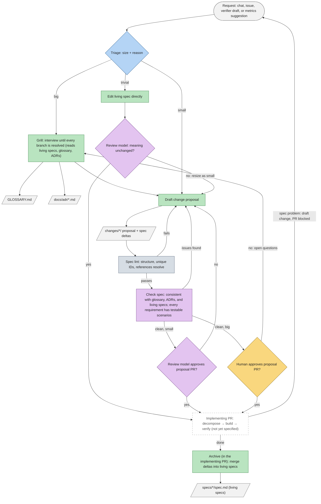

Analyze skills from Matt Pocock and Lauren Tan (PStack). Start creating my software-factory-factory. The idea is that this project will help the user to add and customize skills in a target project.  It should work with the user to design and refine the agent engineering loop. There are standard pieces, with the option to add more decision points. 
Specs: identifying an approach to capturing specs for the overall project and individual features (grilling, personal wiki, second brain, Domain Driven Design, Spec Driven Design, etc.). 
Task decomposition and delegation: (Chief of Staff, Project Manager, etc.), routing tasks to sub-agents with awareness of token costs (option of using a router like OpenRouter, specific cloud models directly like Haiku, or even local models). 
Coding: sub-agents are created and given all necessary context to complete a task, documenting and proving their work as part of their PR, including running deterministic checks, building the project, capturing screenshots or videos to prove that their contribution works as expected and matches the requirements of their subtask. Unit tests may or may not be required. An end-to-end test suite against the built and running project is required. 
Then the most important part will be setting up verification (probably using different, perhaps smarter models than did the coding, identifying skills and patterns Verification: A reviewer/verifier agent (different model than what  did the coding). The end-to-end test suite should be run. Failures should be examined and a decision made whether the test no longer matches the requirements, meaning the change is correct and the test should be modified, or the PR doesn't match the spec and the PR should be rejected with feedback, or their may be a problem with the spec, in which a change to the spec should be suggested to the user.
There should be mechanisms for measuring the effectiveness of the loop (token efficiency, failure rate, how early are failures caught) that can feed back into suggesting further customization of the loop itself.

## Capabilities

Each capability gets a living spec at `specs/<capability>/spec.md` once it has been grilled.

| Capability | Covers | Status |
|---|---|---|
| `spec-management` | Capturing, changing, and checking specs: triage, grilling, proposals, approval, archive | Being grilled ([change](changes/add-spec-management/proposal.md)) |
| `decomposition-and-routing` | Breaking work into tasks, and sending each to a model or sub-agent with token costs in mind (OpenRouter, direct cloud models, local models) | Not started |
| `coding` | Sub-agents that get full context, implement a task, and prove their work in the PR | Not started |
| `verification` | A review model different from the coder, running the end-to-end suite and deciding whether the test, the PR, or the spec is wrong | Not started |
| `loop-metrics` | Measuring the loop (token efficiency, failure rate, how early failures are caught) and suggesting changes to it | Not started |
| `loop-configuration` | The loop config file (sizes, approval policy, model routing, decision points) and the diagram generated from it | Not started |
| `installation` | Setting up and customizing a loop in a target project, such as the card game | Not started |

## The loop

Version 4 shows only the spec-management stage, following [ADR 0001](docs/adr/0001-spec-management-approach.md). Later stages are a single placeholder for now. The sizes and approvers shown are this project's settings; each target project sets its own in its loop config. Rounded boxes are steps, slanted boxes are artifacts, and diamonds are decision points. Colour shows who does each step.

| Colour | Who does the step |
|---|---|
| Yellow | Human |
| Blue | Decision model (cheap, routes or classifies) |
| Green | Generative model (writes content) |
| Purple | Review model (a different, stronger model checks the work) |
| Slate | Deterministic script (no model) |
| Grey | Artifact passed to later steps |
| Dashed | Stage not yet specified |
